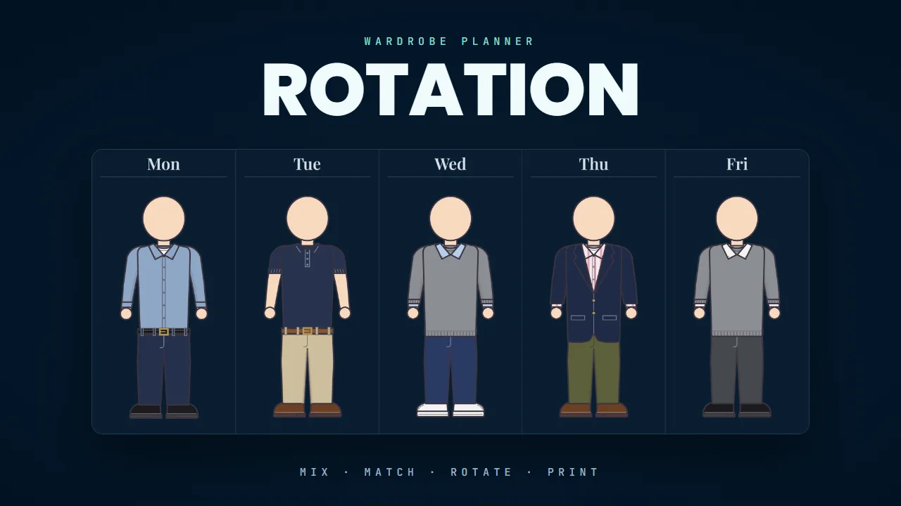

<p align="center">
  
</p>

<h1 align="center">Rotation</h1>

<p align="center">
  <strong>Track your clothes, mix them into outfits, plan a rotation, and print it as a cartoon</strong>
</p>

<p align="center">
  <a href="https://dangervalentine.github.io/rotation/">Live Demo</a>
</p>

<p align="center">
  <a href="https://dangervalentine.github.io/rotation/">
    
  </a>
</p>

<p align="center">
  
  
  
  
</p>

---

Rotation is a wardrobe planner. You log the clothes you own (and the ones you mean to buy), put them together into outfits, and generate a rotation of days that **spreads wear evenly** and **avoids back-to-back repeats**. The finished plan prints as a sheet of cartoon figures, one per day.

It started as the single-file "Workweek Wardrobe" page, which is kept in `reference/` for comparison.

## Features

The four views run in the order you use them, and the app opens on the first one.

**Wardrobe** &mdash; Your collection: owned vs. to buy, what it's worth, and how many days each item is worn. Tap an item's name to open its page, where you edit it; **Shop** opens the product page. Switch between the cost table and a Cards layout.

**Add from link** &mdash; Paste a product URL and the item fills itself in. In local mode the dev server reads the page's JSON-LD `Product` data, then OpenGraph/meta tags, then `<title>`, and guesses category, style and color from the words (`src/lib/productParse.ts`). Published, browsers can't read other sites (CORS), so it guesses from the URL text alone; pages that block bots fall back to the same guess.

**Outfits** &mdash; A mix-and-match workspace. Pick a piece for each slot (the figure previews each option as you move through the list), shuffle the pieces you didn't mark "keep", or use **Try every** to swap one slot through every item. Undo and redo (Ctrl/⌘+Z, Ctrl/⌘+Shift+Z) cover every change. Save looks to a library and wear them on any rotation day.

**Sketches** &mdash; **Create a piece…** at the end of any slot's list sketches something you don't own: pick a style and colour, or take the colour from a photo, and it goes straight into the look. Sketches are listed last on the Wardrobe tab; they aren't counted in the totals and Generate rotation never picks them. **Move to To buy** or **I own this** turns one into a real item.

**Rotation** &mdash; Any days per week (comma-separated names) and 1&ndash;8 weeks. It flags the same pants, shirt or leather shoes on back-to-back days. **Generate rotation** fills the empty days, spreading wear evenly and avoiding those repeats. Days that already have an outfit are never changed, so once some are set the button reads **Fill N empty days**, and it goes away when every day is set.

**Day editor** &mdash; Select a day to edit it in a side panel (a bottom sheet on phones) with the same editor as Outfits: list or gallery, shuffle, wear a saved outfit, or name the day's look and save it as a new outfit. Each open day has its own address (`#rotation/day/3`), and Back closes the panel.

**Print** &mdash; The rotation as cartoon figures on an editorial sheet, one landscape page per week, with your choice of skin tone, hair color and hair style. Print is always light.

**Autosave** &mdash; Every change saves half a second after you make it; the masthead says *Saved*, *Saving…* or *Couldn't save* (with Retry). Until a change is written it is also kept as a draft in the browser, so a failed save or a closed tab doesn't lose it.

**Conflict detection** &mdash; If the saved wardrobe changes elsewhere (you edit `data/wardrobe.json` by hand, a script updates it, or another tab saves), the app notices: on load, when you come back to the tab, as soon as the file changes in local mode, and again right before saving. With nothing waiting to save it just loads the newer version; otherwise it asks whether to keep yours or load the newer one, so nothing is overwritten silently. Replacing the whole wardrobe (Import JSON, Load sample wardrobe, Start empty) asks first.

**Import / Export** &mdash; Move data between modes and devices as JSON from the Wardrobe tab. Files in the original single-file format import too.

**Theming** &mdash; **Auto / Light / Dark** in the masthead. Auto follows the OS, and the choice is remembered in this browser.

## How It Works

### Two ways it saves

| | How you run it | Where data lives |
|---|---|---|
| **Local** | `npm run dev` | `data/wardrobe.json`, through a small dev-server API (`server/devApi.ts`) |
| **Published** | `npm run build`, then host `dist/` anywhere static | This browser's `localStorage`, seeded from the bundled `data/wardrobe.json` |

`npm run preview` serves the built site, so you can try the published (browser) mode locally.

### Generating a rotation

```
Rotation (days × weeks)
        │
        ▼
  Keep every day that already has an outfit
  (its pieces count toward wear)
        │
        ▼
  Fill each empty day, slot by slot
  ├── pick from the items worn least so far (even wear)
  ├── avoid the shirt, pants or leather shoes worn
  │   on a neighbouring day in the same week
  ├── add a layer on some days, at random
  └── match the belt to the shoes
        │
        ▼
  Flag any back-to-back repeats left in the plan
```

Sketches are never generated, and accessories are only ever put on by hand.

### Data shape

See `src/lib/types.ts`: `items[]`, `outfits[]` (named looks), `rotation { days, weeks, looks[] }`, and `figure` (the print character).

- A look is `{ layer, shirt, undershirt, belt, pants, shoes }`, each an item id or `null`, plus an optional `acc[]` of accessory ids.
- An item with `sketch: true` is a sketch (never `owned`); photo sketches keep a small JPEG data URL in `image`.

### Design system

The app is styled by **Rotation**, an editorial menswear design system: ink on newsprint, Playfair Display headlines, tracked uppercase labels, hairline rules, an oxblood accent for actions and a colour for each step (navy, camel, oxblood, ink), in light and dark themes. Tokens live in `design-system/tokens.json` and compile to `src/design-system/tokens.css`; a test fails on stale CSS, duplicate names, or any promised text pair under 4.5:1 contrast. See [`design-system/README.md`](design-system/README.md) for the rules.

## Quick Start

```bash
# Install
npm install

# Develop (http://localhost:5173, saves to data/wardrobe.json)
npm run dev

# Test (model rules, generator, URL parsing, routes, figures, design tokens)
npm test

# Type-check
npm run typecheck

# Rebuild tokens.css after editing design-system/tokens.json
npm run tokens

# Build, then serve the published (browser storage) mode locally
npm run build
npm run preview

# Lighthouse audit of the preview build (see scripts/lighthouse.mjs)
npm run audit
```

Pushing to `main` runs the tests, builds, and deploys to GitHub Pages.

## Tech Stack

- **React 19** &mdash; UI with hooks
- **TypeScript 7** &mdash; Types across the app, model and tests
- **Vite 8** &mdash; Build tooling, dev server, and the local file API
- **Radix UI** &mdash; Accessible dialog, select, checkbox and toggle-group primitives
- **SVG** &mdash; Cartoon figures and garment art, drawn in code
- **Vitest** &mdash; Unit and golden-snapshot tests

## Project Structure

```
src/
├── App.tsx                 # Shell — masthead, tabs, saving, theme
├── main.tsx                # Entry point
├── styles.css              # App styles (tokens only)
│
├── components/
│   ├── WardrobeView.tsx    # Collection, costs, cards, item pages
│   ├── OutfitsView.tsx     # Mix-and-match workspace and outfit library
│   ├── LookEditor.tsx      # Slot editor shared by Outfits and Rotation
│   ├── RotationView.tsx    # Weeks of days, generator, day panel
│   ├── PrintView.tsx       # Printable sheet of cartoon figures
│   ├── SketchCreator.tsx   # "Create a piece…" for items you don't own
│   ├── DetailFields.tsx    # Style details (sleeve, length, pattern…)
│   ├── photo.ts            # Photo → small JPEG, on this device
│   └── common.tsx          # Shared bits
│
├── lib/
│   ├── types.ts            # Wardrobe data shape
│   ├── model.ts            # Rules and the rotation generator
│   ├── storage.ts          # Local file / localStorage saving
│   ├── route.ts            # Hash routes (#rotation/day/3)
│   ├── history.ts          # Undo/redo for the outfit builder
│   ├── productParse.ts     # Add from link
│   ├── sketch.ts           # Sketched pieces
│   ├── styles.ts           # Garment styles and their options
│   ├── palette.ts          # Curated garment colours
│   ├── colour.ts           # Colour from photo pixels
│   ├── figure.ts           # Cartoon figure renderer
│   └── figure/             # Body, head, tops, layers, bottoms, belts, shoes
│
└── design-system/          # Components, styles and compiled tokens

design-system/              # tokens.json (source of truth) and usage guides
server/devApi.ts            # Dev-server API for data/wardrobe.json
data/wardrobe.json          # The wardrobe (and the published seed)
scripts/                    # Token build, Lighthouse audit, garment gallery
test/                       # Vitest suites
reference/                  # The original single-file page
```
